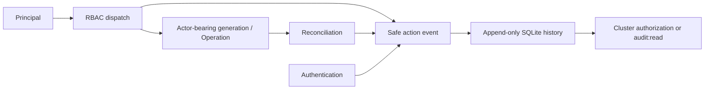

# 0013 — Casbin tuples, local/OIDC identity and protected sessions

Status: Accepted

## Context

Multi-user administration needs permissions per resource, action and cluster, including a separate credential-reveal boundary. OpenEverest's Casbin tuple is useful without importing Kubernetes RBAC. Browser sessions and CLI automation have different credential-handling requirements.

## Decision

Use Casbin with request/policy tuple `sub, res, act, obj`, role inheritance `g = _, _` and glob matching on resource, action and object. Name subjects `user:<name>`, `group:<oidcGroup>` and `role:<name>`. Authorize cluster-scoped objects by cluster-name glob and global objects by `*`; filter lists, events, metrics and streams per authorized object. Evaluate allow rules with explicit-deny support: a matching deny is not canceled by a broad allow.

Provide built-in admin, operator and viewer roles. Admin has all permissions. Operator manages clusters, backups, restores, database users and operations, reads events/monitoring and storages/providers, but cannot reveal credentials or administer accounts/RBAC/settings. Viewer is read-only without credentials. Credential reveal requires `read` on the separate `cluster-credentials` resource; operational read access does not imply it.

Support local accounts with Argon2id password hashes, and server-side OIDC authorization-code flow with PKCE and group-claim mapping. First-run bootstrap creates an admin account marked for password change from the installer-supplied secret. UI access JWTs use EdDSA and an HttpOnly, Secure-in-HTTPS, SameSite=Strict cookie; enforce CSRF header checks on unsafe cookie-authenticated requests and rotate refresh sessions. Do not store access credentials in browser local storage.

Use owner-scoped API tokens for `karactl`/automation, with `kk_` prefix, hashed storage, revocation and optional expiry. Tokens exercise their owner's current RBAC rather than granting a parallel platform role. Public auth routes are explicitly classified, not accidentally exempted through missing metadata.

### Audit attribution

Rank **coverage first, security second, maintainability third**: audit every successful mutation and credential reveal; never log bodies/secrets; avoid a second per-operation convention. Central successful-action auditing uses generated RBAC dispatch metadata. Authentication owns login/logout/OIDC success/failure, including unauthenticated failures and redirects.

| Alternative | Coverage (weight 3) | Security (weight 2) | Maintainability (weight 1) | Weighted score (1–5) |
| --- | --- | --- | --- | --- |
| Central dispatch plus authentication events | 5: uniform classified-action coverage | 4: safe metadata only | 5: one dispatch convention | 28/30 |
| Per-handler audit | 3: new handlers must remember the append | 4: domain-specific messages, repeated secret boundaries | 3: duplicated attribution/review | 20/30 |

Per-handler auditing would win if indispensable audit details were unavailable from dispatch and uniform coverage could be enforced. Here action/resource metadata is sufficient; engine diagnostics remain separate. **No request/response bodies, passwords, tokens, storage secrets or private keys are logged.**

Local actors use persisted account names; OIDC actors add `(oidc: issuerURL)` from the verified issuer; token actors use owner plus public name/ID. Store context carries attribution into desired-state generations and queued Operations, then reconciliation events. Autonomous actors are `reconciler`, `scheduler`, `system:startup` and `system` for orphan-volume janitor work. Cluster-management events retain cluster scope and resource `clusters`/target cluster name; janitor events keep their original cluster scope with resource `orphaned-volumes`/target hostname. Noncluster records require `audit:read` on `*`. Exact actor/resource filters never widen visibility.

Failure-first risk: a crash/event-append failure after a remote mutation. Neither alternative makes the remote action and SQLite append atomic. Report audit failure and inspect operation/resource state rather than treating absence as proof nothing happened. Append-only event APIs and SQLite WAL provide normal restart durability, not tamper evidence, protection against root compromise or inconsistent/lost storage. Audit and cluster events share indefinite retention without automatic age/count pruning.

Regression coverage should exercise successful mutations/reveal, authentication outcomes, OIDC/token differentiation, generation attribution after restart, exact filters and noncluster denial without `audit:read`, with secret-free serialized events.

## Consequences

Identity and authorization remain independent of Zerops's project token. UI hiding is not enforcement; every server operation and streamed/listed object is checked. OIDC group naming avoids collisions with local accounts. Policy updates and account/token lifecycle must take effect without letting a revoked identity retain management authority. This is tuple compatibility with OpenEverest, not drop-in policy/API compatibility.

## Alternatives considered

- **Three hardcoded roles only:** simple but cannot express per-cluster policies or OIDC groups.
- **Zerops RBAC only:** protects the shared infrastructure principal, not Karakoram users/resources.
- **Browser bearer tokens in local storage:** simplifies transport but increases script-readable credential exposure.
