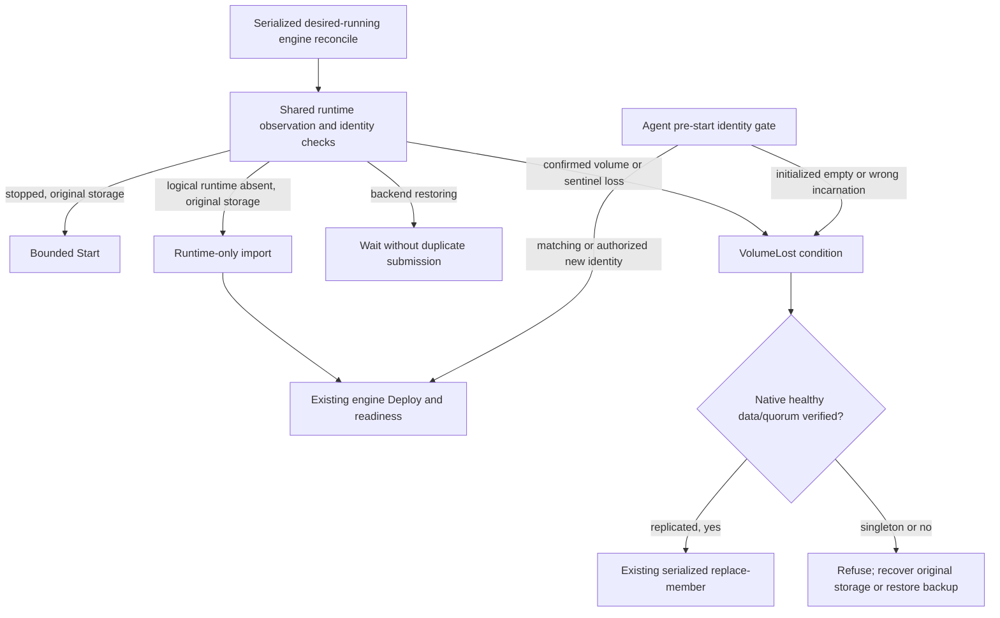

# 0037 — Desired-running runtime recovery and durable data identity

Status: accepted; live backend fault verification remains required.

## Context and ranked drivers

Member runtime services and persistent volumes have separate lifecycles. A deployed member can lose its runtime while retaining its data, or keep a logical volume record after its physical data has disappeared. Scheduler health, a familiar hostname, and ownership markers do not prove that an initialized database still has its original data.

Priorities, in order:

1. **Data safety:** no empty-volume initialization under an initialized member identity; no API failure interpreted as absence; no foreign service adoption.
2. **Automatic recovery:** start an externally stopped desired-running member; recreate a confirmed-absent runtime against its original retained volume; replace a lost replica only through native data-transfer/quorum safeguards.
3. **Operational clarity:** bounded submissions, durable receipts, precise `VolumeLost` conditions and explicit restore instructions when no safe data copy is verified.
4. **Maintainability:** one neutral recovery policy shared by database and stateless engine families, without duplicating backend lifecycle fencing.

Fitness scenarios are zero volume-creation requests during retained-runtime recovery, at most one recovery mutation per invocation, at least one minute between failed/ambiguous submissions for the same member, and a pre-start refusal when an initialized member has neither its sentinel nor recognizable retained native metadata.

## Alternatives and comparison

Scores are 1–5; weights emphasize safety over speed of recovery.

| Placement | Safety (5) | Recovery (3) | Operability (2) | Maintenance (2) | Weighted total |
| --- | ---: | ---: | ---: | ---: | ---: |
| Backend-only restoration from durable infrastructure records | 3 | 3 | 3 | 4 | 38 |
| Separate native engine implementations for every runtime fault | 4 | 4 | 3 | 2 | 42 |
| Shared engine runtime policy, backend primitives, native replacement workflows | 5 | 4 | 5 | 4 | 55 |

Backend-only restoration remains useful for derived [Nomad](https://developer.hashicorp.com/nomad) jobs and [Docker](https://www.docker.com) services, but it cannot infer cluster suspension, initialized data, or whether surviving replicas can safely replace a member. Independent engine implementations could express those facts, but would duplicate absence, ownership, start, import, backoff and receipt handling across five families.

## Decision

Use `engine.ReconcileRuntime` for desired-running logical services. Callers exclude deleting, suspended, removed and operation-owned stopped members. Existing operation serialization remains authoritative; a stale observed cluster phase is not itself desired stop intent.

The helper checks infrastructure errors and ownership, verifies the original durable volume identity, and:

- starts an observed `STOPPED` runtime;
- imports **only the runtime** after confirmed logical absence, preserving hostname, member token, replica count and retained-volume reference;
- returns imported services to each engine's existing deployment/configuration workflow;
- leaves backend `CREATING`/other transitional observations alone rather than competing with backend restoration;
- reports storage loss instead of importing a replacement volume.

The member's durable `RuntimeRecovery` journal records the operation handle, cooldown, initialized-data receipt and volume-loss observation. Recovery attempts emit `RuntimeRecovery` events. A deterministic replacement operation ID makes missing-volume queueing idempotent across control-plane restarts. Failed/completed attempts are not endlessly re-enqueued under fresh IDs.

Backends may return `infra.VolumeLostError` only for authoritative physical absence behind the recorded, owned logical volume incarnation. Unknown inventory, unavailable nodes, changed ownership and placement conflicts remain ordinary safe errors. The shared helper checks both the volume hostname and logical service ID before using that classification.

### Volume identity sentinel

Stateful member configuration includes cluster UID, member name, volume hostname, logical volume service ID and the CP's initialized-data receipt. Stateless services have no volume identity.

Before applying engine configuration **and before every supervised child start/restart**, the shared node agent checks `karakoram/volume-identity.json` on the data volume. An existing sentinel must match the full identity. Corrupt/mismatched sentinels fail closed. An initialized member with a missing sentinel cannot start fresh on an empty mount.

For a newly authorized member, the agent durably writes the sentinel before engine startup. Its cached configuration consumes that one-time fresh authorization by recording `Initialized=true`; a later restart cannot replay a stale fresh-start grant. The running agent also remembers verified provenance before the CP's next receipt is committed. Native readiness and the member's durable engine stage establish the CP receipt; mere platform allocation or ownership is not evidence of successful database initialization.

Existing initialized installations are adopted only when recognizable native durable metadata exists: [MongoDB](https://www.mongodb.com) [WiredTiger](https://source.wiredtiger.com) metadata, [PostgreSQL](https://www.postgresql.org) `PG_VERSION` plus control data, [Elasticsearch](https://www.elastic.co/elasticsearch) [Lucene](https://lucene.apache.org) node-state metadata, or [RabbitMQ](https://www.rabbitmq.com) node-bound [Khepri](https://github.com/rabbitmq/khepri)/Ra configuration plus a recognized WAL header. A cache file, directory, PID or arbitrary nonempty data directory is insufficient. These are conservative retained-data checks, not database-integrity repair; the native engine must still open and validate its state normally. Unknown layouts fail closed with recovery guidance rather than being treated as empty new clusters.

PostgreSQL's existing initialization receipt and explicit [pgBackRest](https://pgbackrest.org) restore ownership remain in force. The generic sentinel identifies whole-volume loss; it does not prevent an authorized HA replica clone or explicit restore on an otherwise matching volume.

### Native replacement safety

Missing logical storage or an authenticated agent `VolumeLost` observation enters the existing `replace-member` workflow only after engine-native surviving-data evidence:

- MongoDB requires a distinct surviving writable primary in the affected replica set.
- RabbitMQ requires healthy surviving brokers and the existing lost-majority/queue safety gates.
- Elasticsearch requires surviving owned membership and all primary shards available (`green`/`yellow`); missing primary copies require retained-data recovery or snapshot restore.
- PostgreSQL HA requires a surviving writable primary with healthy [etcd](https://etcd.io) quorum. [Supabase](https://supabase.com)'s database core uses the same policy.

Replacement retains the existing join, catch-up, quorum, drain and retirement checks. No forced election, unsafe bootstrap, force-boot, empty primary allocation or destructive same-identity reseed is introduced. Singletons and unverified/no-survivor cases expose `VolumeLost`, refuse fresh initialization and direct the operator to recover original storage or restore into a new cluster.

## Failure-first review and consequences

- **Runtime deletion races import:** fresh observation plus absent-only backend import conflicts prevent overwriting a same-name replacement. Backend ownership/fencing remains necessary.
- **Stop/suspend races healing:** only the serialized cluster owner invokes recovery; active cleanup and restore own their stops. Backends retain their durable desired-state/CAS/delivery fences.
- **A replacement mount is silently empty:** the sentinel is on the mounted data volume and the CP receipt is outside it. Both the initial apply and child retry gate refuse fresh initialization.
- **The CP crashes after queueing:** deterministic operation identity avoids duplicate replacement workflows. An old operation failure remains actionable rather than causing an unbounded destructive retry loop.
- **The agent restarts with a stale first-start config:** consuming fresh authorization in the local cache closes that bypass; same-process provenance closes the interval before CP observation.
- **A legacy layout is unfamiliar:** safety wins over availability. No sentinel should be manually invented or copied to suppress the refusal; retain native data and diagnostics for supported recovery.
- **All copies are lost:** adding an empty member cannot recover acknowledged data. Native surviving-copy gates refuse automation and status identifies restore/recovery as required.
- **Node-local inventory is unavailable:** no claim of authoritative physical absence is made. Repair the original node/platform access or use the supported explicit replacement/restore procedure.

The policy is additive to existing backend restoration, not a second backend restorer. Removing it later would require migrating the persisted recovery/initialized receipts; it does not change native on-disk database formats or permit deletion of unrelated services.

## Automated fitness functions and sources

- `internal/engine`: `TestRuntimeRecovery*` covers stopped/missing runtime, retained volume identity, storage loss, foreign observations, bounded retries, physical-loss classification, agent receipts and idempotent replacement admission.
- Engine-family `TestMemberRuntimeRecovery` and Supabase `TestComponentRuntimeRecovery` exercise the neutral fake backend adapters.
- `internal/agent`: `TestVolumeSafety*` covers fresh identity, restart, legacy metadata adoption, initialized empty-volume refusal, corrupt/wrong identity and consumed cached authorization.
- Existing native replacement and backend lifecycle tests remain the guards against unsafe reseeding, quorum bypass and restoration/stop races.

Implementation: `internal/engine/runtime_recovery.go`, each engine's runtime recovery adapter, `internal/agent/volume.go`, `internal/agentapi/volume.go`, and `internal/infra/volume_loss.go`.

Ra WAL magic reference: [RabbitMQ Ra `ra_log_wal.erl`](https://github.com/rabbitmq/ra/blob/main/src/ra_log_wal.erl). Khepri storage identity: [RabbitMQ `rabbit_khepri.erl`](https://github.com/rabbitmq/rabbitmq-server/blob/v4.3.6/deps/rabbit/src/rabbit_khepri.erl). Backend fault recipes must still be exercised; unit evidence is not live data-integrity proof.
