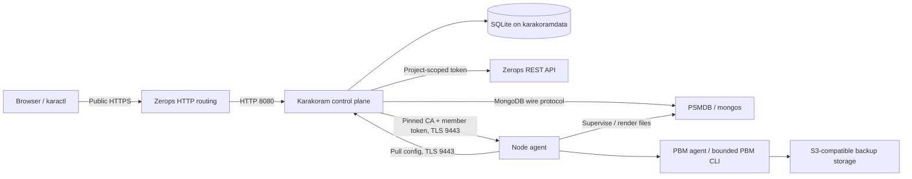
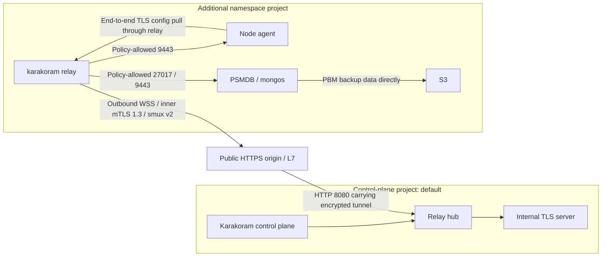

<!-- SPDX-License-Identifier: Apache-2.0 -->
<!-- Copyright 2026 The Karakoram Authors -->
# Architecture

Karakoram is a self-hosted control plane for PSMDB/PBM and RabbitMQ on Zerops, managing its own project and additional projects as namespaces. It does not run Kubernetes or reuse OpenEverest's Kubernetes provider runtime. The [ADRs](adr/README.md) record the design rationale; current implementation details and explicit limitations are summarized here.

## Deployment and trust boundaries

- **Control plane:** one runtime service, normally `karakoram`, with one container and a `karakoramdata` Local Storage volume mounted at `/mnt/karakoramdata`. Public UI/API is HTTP 8080 behind Zerops HTTPS; the private agent listener is TLS 9443. The service holds its own project's token, sealed credentials for additional namespaces and the operator-held master key.
- **Data-bearing members:** one Ubuntu 24.04 runtime plus one Local Storage volume per mongod, including config servers. Singleton services provide stable replica-set identities; horizontal runtime scaling is not MongoDB replication. Persistent dbpath is under `KARAKORAM_DATA_DIR/db`.
- **Routers:** one stateless mongos service per sharded cluster, potentially multiple containers. It has no durable data volume. Multiple router containers share a service identity; they are not independent data-bearing voters.
- **Node agent:** the same executable as the control plane, started as `karakoram agent`, supervises mongod/mongos and PBM agents and exposes a bounded private API. It is not a remote shell.

Private networking is not a security boundary on its own: agent traffic has pinned trust roots and per-member bearer tokens. Database keyfile authentication, database TLS, internal agent TLS and public HTTPS protect different paths. See [security](security.md).

## Namespaces and relay routing

Each namespace represents one existing Zerops project and its project-scoped Backend/token. `default` is the control plane's own project and uses direct private networking. Other namespaces have one private relay running `karakoram relay`, uploaded from the same executable as members. Names are immutable; cluster and storage names are unique per namespace. See [ADR 0018](adr/0018-multi-project-namespaces-relay.md) and the [namespace guide](user-guide/namespaces.md).

| Traffic | `default` | Additional namespace |
| --- | --- | --- |
| Zerops infrastructure API | Environment-token Backend | Namespace-token Backend |
| MongoDB administration | Direct private TCP | Namespace smux dial stream to private 27017 |
| Control plane → node agent | Direct pinned TLS 9443 | Namespace dial stream; agent TLS/token unchanged |
| Agent configuration pull | Direct internal TLS listener | Private relay 9443 → reverse stream → internal TLS listener; end-to-end TLS |
| PBM data → S3 | Direct member-to-S3 | Direct member-to-S3; not tunneled |

The hub admits only enrolled relay certificate identities/serials and keeps one active session per namespace. Target policy is pushed on change/reconnect and refreshed every thirty seconds; the relay validates host/port and DNS answers before dialing. The namespace reconciler runs independent project workers, tracks token/relay health, renews client certificates and redeploys mismatched executable digests. Reconciliation, scheduling, orphan cleanup and monitoring use namespace-qualified identities and backends. A token/routing failure affects that namespace's clusters, not every project.

SQLite migration 004 follows actor/audit migration 003 and assigns existing clusters/events/metrics to `default`. Default cluster/storage secret identities retain their legacy encoding, so no secret re-sealing occurs. Public RBAC objects use `<namespace>/<cluster>` or `<namespace>/<storage>`; namespace registry objects use the namespace name. Audit visibility uses `<namespace>/<cluster>`, `<namespace>` or global `*` according to the event scope. Cross-namespace recovery additionally checks source `backups/export` and uses the recorded source storage.

## Code boundaries

| Area | Responsibility |
| --- | --- |
| `internal/server`, `internal/api` | Runtime wiring, generated strict HTTP contract, handlers, session/RBAC enforcement |
| `internal/domain`, `internal/store` | Resource types, SQLite WAL/migrations, transactional intent, checkpoints, events and secrets |
| `internal/reconciler` | Per-cluster serialization, timed/triggered reconciliation, durable operation execution and cleanup |
| `internal/engine` | In-process Provider registry and narrow reconciliation/data-plane interfaces |
| `internal/engine/psmdb` | Catalog/defaults/validation, replica sets/sharding, topology observation, rolling changes, access/PKI |
| `internal/engine/psmdb/pbm` | Backup/PITR/inventory/restore/checkpoint orchestration |
| `internal/engine/elastic` | Elasticsearch catalog/defaults/validation, formation/topology, rolling maintenance, Stack lifecycle, security/PKI and native S3 snapshot/restore/cleanup |
| `internal/infra`, `internal/infra/zerops` | Backend intent and owned thin Zerops REST translation |
| `internal/namespaces` | Namespace lifecycle, sealed project credentials, per-project Backends, relay deployment/health/renewal |
| `internal/relay` | Outbound WebSocket carrier, dedicated mTLS PKI, smux streams, target policy and reverse agent listener |
| `internal/agent`, `internal/agentapi` | Node supervision, protected file rendering, private command/config protocol |
| `internal/agent/elastic` | Elastic product rendering below `DATA_DIR/karakoram`, keystore management, supervised processes, explicit engine readiness and product metrics |
| `internal/auth`, `internal/rbac` | Argon2id/OIDC identity, sessions/API tokens, persisted Casbin policy |
| `internal/scheduler`, `internal/events` | UTC backup schedules/count retention, durable events/SSE delivery |
| `internal/monitoring` | Agent scrapes, SQLite sample history, UI series and Prometheus exposition |
| `internal/cli`, `ui/`, `internal/ui` | Generated-client CLI, typed React SPA and embedded serving |
| `internal/engine/rabbitmq`, `internal/engine/rabbitmq/mgmt` | Broker catalog/lifecycle, Management API access, exposure, definitions backup/restore and retention |
| `internal/agent/rabbitmq`, `internal/engine/rabbitmq/rmqspec` | Broker rendering/supervision, bounded lifecycle commands, metrics and shared node protocol |
| `internal/server/rabbitmq.go`, `internal/cli/rabbitmq.go`, `ui/src/engines/rabbitmq` | Engine-owned access API/CLI, creation controls, Access tab and monitoring panels |

The `psmdb`, `rabbitmq` and `elasticsearch` providers and the `zerops` backend are implemented. The seams isolate present responsibilities; they are not dynamically installable plugins or promises of compatibility with another project's providers.

## Multi-engine extension

Providers are registered centrally in `internal/server/providers.go`; PSMDB remains the explicit default. Provider metadata publishes capabilities, durable operations, process names, component limits and backup types. Generic API preflight rejects unsupported operations/backup types and validates log process names; a cluster's provider is immutable. Optional extra components, engine-owned JSON options, password-free connection endpoints, and provider/location backup provenance extend the shared domain and OpenAPI models without applying MongoDB defaults to other engines. Non-PSMDB CLI creation delegates defaults to the provider and accepts generic topology, replica count and JSON engine options.

The UI's `EngineUI` registry provides optional wizard sections, detail tabs, monitoring panels and topology summaries. Generic actions/tabs are gated by provider capabilities and operations; forms use provider topology/component/backup metadata, logs use declared process names, and connection endpoints are shown without credentials. Host CPU/RAM/disk panels remain available to every engine. Missing capability metadata retains the PSMDB-compatible presentation.

Optional provider interfaces supply namespace relay targets, monitoring metric vocabulary and retained-backup deletion. Namespace routing and monitoring no longer need engine-specific imports; shared certificate issuance lives in `internal/pki`. Zerops subdomain access supplies public HTTPS endpoints where an engine needs them. Engine-specific data-plane APIs remain in engine-owned packages/routes, rather than becoming generic MongoDB endpoints.

Node runners implement `agent.Engine` and receive the protected `Node` toolkit; the common agent loop owns configuration pulls/cache, TLS/token authentication, generic routes, metrics, process supervision and durable maintenance/stop holds. `KARAKORAM_ENGINE`, configuration `engine` and engine-owned `engineSpec` select and configure a compiled-in runner. Empty engine names retain PSMDB behavior; unknown engines and mismatched configurations are rejected. Readiness forwards engine-specific arguments. See [ADR 0005](adr/0005-engine-provider-seam.md) and [ADR 0008](adr/0008-node-agent-protocol.md).

Readiness accepts a leading `--engine=<name>` argument before engine-specific arguments. It overrides `KARAKORAM_ENGINE`, so platform exec checks can select the compiled-in engine without the service environment; for example, `karakoram agent readiness --engine=psmdb`. Without either selection, readiness retains the PSMDB default.

## Desired state and durable operations

Clusters have desired `spec`, observed `status`, generation/observedGeneration and provider-owned internal state. Spec-driven work includes creation, membership/resource/disk/version changes, shard addition, TLS mode, exposure, backup configuration and PITR. Imperative work is a persisted Operation: backup, delete-backup, restore, raise-fcv, restart, replace-member, rotate-system-user or rotate-tls.

The provider exposes `Describe`, `ApplyDefaults`, `Validate`, `Sync`, `Status`, `RunOperation` and `Cleanup`. It receives store/secret/backend/agent capabilities rather than constructing generic API responses. A cluster worker serializes operations and Sync; unrelated clusters can progress separately. Steps persist checkpoints and platform identifiers and observe completion before advancing. Pending PSMDB work normally requeues after five seconds; converged clusters after thirty seconds. One Sync call performs at most one disruptive database/infrastructure step.

Neither an accepted HTTP mutation nor a successful Zerops configuration Process means a database is healthy. Platform Process success is `FINISHED`; `FAILED` and `CANCELED` are errors. Engine observation supplies health, elected role, lag, binary version and FCV. There is no distributed exactly-once transaction across SQLite, Zerops and PBM; durable IDs, receipts and observation reduce unsafe replay, and uncertain outcomes remain explicit errors.

Failed platform actions are retried with durable backoff. When an action is rate-limited, Karakoram persists a retry deadline rather than continuously resubmitting it; CPU-mode waits are surfaced as `PlatformCooldown`.

## Provisioning and database changes

A member progresses through planned/imported/deployed/healthy state. Karakoram imports runtimes/volumes **without inline pipeline YAML**, then creates an app version, uploads a gzip-tar containing its own executable and deploys the complete generated pipeline. Version-pinned apt preparation text determines the cached runtime image. `temporaryShutdown` prevents overlapping writers on a dbpath, and readiness uses `/var/www/karakoram agent readiness`.

The first member bootstraps a set and `userAdmin` through MongoDB's localhost exception. Authenticated administration establishes the five system accounts. Sharded plans initialize `cfg`, shard sets `rs0` onward and routers, then register shards. New members initially join non-voting/priority-zero, synchronize and are promoted after observed health/lag. Removal/rolling changes check quorum and transfer primary leadership as needed. Config servers precede shards and routers in binary upgrades; FCV promotion is separate.

Cluster names are 2–12 lowercase alphanumeric characters beginning with a letter. Runtime identities are `{cluster}m{index}`, `{cluster}s{shard}m{index}`, `{cluster}c{index}` and `{cluster}r`; volume names append `v`. Monotonic indexes are not reused after replacement. Compact generated hostnames leave room for component and member suffixes.

## Node-local durability

Agents pull assigned configuration from `/internal/agent/v1/config` and cache `DATA_DIR/karakoram/config.json` (0600). They re-pull every 60 seconds and on reload. Data-bearing members can start from the cache while the control plane is unavailable; first startup without a cache cannot. Stateless routers lose their cache across runtime replacement.

Rendered keyfiles are 0400; configs/certificates are owner-only. `controls.json` durably records explicit maintenance/process-stop holds independently of pulled configuration. Physical restore may intentionally stop mongod and let PBM exit successfully; neither periodic pulls nor agent restart may remove those holds. PBM initiation receipts under `pbm-receipts/` preserve completed responses and distinguish an interrupted, ambiguous initiation from a safe retry. See [operations](operations.md#node-agent-semantics).

## Recovery, monitoring and events

PBM agents run on every mongod, including config members, and never on mongos. Sharded commands run through the config-server replica set. S3 destinations and cluster-specific prefixes separate recovery histories. Restores checkpoint PITR disabling, balancer/router handling, maintenance, offline physical progress, process recovery, restored-user reconciliation, prefix resync and cleanup. A successful restore requiring PITR continuation queues a fresh base backup before re-enabling slicing.

The control plane owns UTC schedules and successful-backup count retention. Control-plane downtime pauses new scheduling/retention; existing PBM operations and already configured PITR run on members. MongoDB backup objects are independent of SQLite control-plane backups.

Agents export member metrics. The collector defaults to 30-second scrapes and 24-hour sample retention. JSON series derive reset-aware counter rates; `/metrics` exports authenticated Prometheus text with per-cluster authorization. PMM is not shipped. Durable events feed `/api/v1/events/stream`; SSE is an acceleration with replay IDs, not the persistence layer.

## Failure domains

There is **no control-plane HA**, guaranteed member anti-affinity, or rack/zone guarantee. Local Storage pins a member to a single machine, and separate services/volumes can be co-located. Best-effort placement fingerprints report uncertainty, not certification. Public TCP requires project IPv6 or dedicated IPv4 and does not implement automatic replica-set external split horizons. Review [limitations](limitations.md), [state recovery](operations.md#control-plane-state-backup-and-recovery) and [public access](user-guide/users-tls-access.md#public-exposure-and-discovery) before relying on availability or external failover.

## RabbitMQ

RabbitMQ uses the same provider, namespace, secret, operation and node-control boundaries, not MongoDB/PBM semantics. The catalog pins RabbitMQ 4.3.5/4.3.6 and Erlang 27.3.4.17 from Team RabbitMQ apt repositories. Each 1/3/5/7-node cluster has one singleton Ubuntu runtime and one ≥5 GB Local Storage volume per broker, stable node identity and Khepri metadata. Classic-config discovery is supplemented by observed explicit joins. Quorum queues are the managed default; classic messages are not replicated.

Rolling changes gate on quorum, drain client traffic and stop the broker before disruptive platform actions because Zerops's roughly five-second SIGTERM deadline is insufficient. Durable maintenance holds prevent premature restart; configuration acknowledgement, running membership and revive gate the next node. Scale-down grows quorum replicas/migrates streams before shrink/forget/deletion. Feature flags are enabled after all binary upgrades finish; only 4.3.5 → 4.3.6 is cataloged. Erlang distribution TLS is fixed at creation.

Engine-owned Management API routes administer vhosts/users/grants/policies through namespace-aware dialing; they are direct changes, not a second declarative topology controller. Definitions backups are gzip JSON in S3, preserve sensitive application-user hashes and exclude reserved users/grants before upload; restore merges and repeats that filter for older backups. They contain no messages and no PITR. Native management exposure is opt-in HTTPS at Zerops L7 with a private HTTP hop, separate from allowlisted per-node AMQPS routes. Built-in monitoring scrapes loopback Prometheus and exports a fixed RabbitMQ vocabulary. See the [RabbitMQ guide](user-guide/rabbitmq.md) and [ADRs 0020–0022](adr/README.md).
