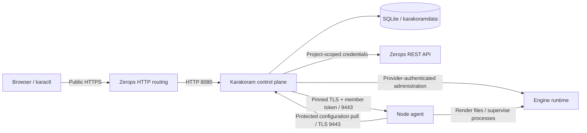

<!-- SPDX-License-Identifier: Apache-2.0 -->
<!-- Copyright 2026 The Karakoram Authors -->
# Architecture

Karakoram is a self-hosted control plane that reconciles engine clusters on Zerops across one or more projects.

## Deployment and trust boundaries

- **Control plane:** one runtime service, normally `karakoram`, with one container and a `karakoramdata` Local Storage volume mounted at `/mnt/karakoramdata`. UI/API traffic enters through public HTTPS; the private agent listener uses TLS 9443. SQLite stores desired state, observations, operations, events and encrypted secret values. The master key is a separately managed service secret.
- **Data-bearing members:** singleton Ubuntu 24.04 runtimes with separate Local Storage volumes and stable identities. Increasing a runtime's container count is not engine replication.
- **Stateless components:** provider-supported auxiliary runtimes do not have durable data volumes. Containers sharing a service identity are not independent data-bearing members.
- **Node agent:** `karakoram agent` supervises the selected engine and exposes a bounded private API, not a remote shell.

Private networking alone is not an authentication boundary. Agent traffic uses pinned trust roots and per-member bearer tokens. Public HTTPS, internal agent TLS and engine authentication/TLS protect different paths. See [Security](security.md) for credentials, project-token authority and secret-storage limits. Backup transfer paths are documented in [Backups and storage](backups.md).

## Namespaces and relay routing

A namespace selects an immutable backend kind and target with its infrastructure credentials. Backends are Zerops (targets are Zerops projects), the experimental [Dokploy backend](dokploy.md) (Dokploy environments on a Docker Swarm), and the experimental [Nomad backend](nomad.md) (Nomad namespaces on an operator-managed cluster). `default` is the control plane's own target and uses direct private networking. Additional namespaces use an outbound relay only when their backend's `BackendInfo.Relay` requires one; all three current backends require it.

The relay opens an outbound WebSocket connection through public HTTPS and carries an inner mutually authenticated TLS tunnel. Provider-approved administration traffic and protected agent traffic use namespace-qualified streams; agent configuration pulls retain end-to-end TLS. A namespace token or relay outage interrupts management of that namespace, not every project. The relay is not application networking.

See [Namespaces and relays](namespaces.md), the [relay threat model](security.md#relay-threat-model) and [ADR 0018](adr/0018-multi-project-namespaces-relay.md).

## Infrastructure backends

The server composition root registers compiled-in factories in `infra.Registry`. Each factory constructs and validates a namespace's `Target`; engines use `infra.Backend`, not the platform client. Neutral `ServiceSpec` values distinguish runtimes from independently identified persistent volumes. `Deployment` pairs an executable artifact with a structured `RuntimeSpec`; each backend renders its own manifest and supplies its runtime `Layout`. Operations remain opaque handles polled through `OpStatus`, and errors use neutral classes.

Backend capabilities describe optional public routing, disk growth, quotas, placement, logs and other resource/runtime features. Engine capability gates reject unsupported requests. `GET /api/v1/backends` publishes registered kinds and capabilities; namespace responses identify their backend and enabled capabilities. All backends must pass the shared contract suite. See [ADR 0030](adr/0030-backend-neutral-infrastructure-contract.md); the registry does not imply support for an unregistered platform.

## Desired state and durable operations

Clusters separate desired `spec` from observed `status`, with generation tracking. Mutations persist intent before reconciliation. Per-cluster workers serialize synchronization and imperative operations; unrelated clusters can progress independently. Providers persist checkpoints and platform identifiers, then observe completion before advancing disruptive work.

Neither HTTP acceptance nor a successful infrastructure configuration process proves engine health. There is no distributed exactly-once transaction across SQLite, Zerops and engine/storage APIs: durable identifiers and observation constrain replay, while ambiguous outcomes require investigation. [Clusters and operations](clusters.md#operations-and-status) defines generations, operation phases, health, cancellation and wait behavior.

## Node-local durability

Agents cache assigned configuration on the data volume with owner-only permissions. Existing data-bearing members can start from that cache during control-plane downtime; first startup without a cache cannot. Stateless runtimes lose cached configuration when replaced.

Rendered credentials, certificates and configuration are restricted to the runtime owner. Explicit maintenance and process-stop holds are persisted separately from pulled configuration, so a configuration refresh or agent restart does not silently release them. Restore/restart recovery remains provider-specific: use the engine operations and recovery guides rather than manually overriding holds.

## Recovery, monitoring and events

The control plane owns scheduling and count retention; its downtime pauses new scheduling and retention. Already-started engine-side work can continue without the control plane. Engine backups and control-plane state backups protect different assets: preserve both the SQLite state and its master key as described in [state backup and recovery](operations.md#control-plane-state-backup-and-recovery).

Agents expose member metrics for control-plane collection, history and authenticated Prometheus export. Persisted events feed live UI/API updates; the live event stream is an acceleration, not the persistence layer. See [Monitoring and events](monitoring.md) and [API pagination and events](api.md#pagination-and-events).

## Failure domains

The control plane is single-replica. Local Storage is tied to a single host, and independent member services do not establish host/rack/zone separation. Engine replication cannot compensate for every shared-host failure. See [Limitations](limitations.md) before selecting availability and recovery objectives.

## Engine providers

Providers are compiled into Karakoram, not dynamically installable plugins. Each owns its version catalog, validation/defaults, topology, health observation, lifecycle checkpoints, access APIs and backup semantics. Shared interfaces handle infrastructure, namespaces, secrets, operations and monitoring; capability metadata gates supported UI/API actions. A cluster's provider is immutable.

Optional auxiliary services use ordered `ComponentDef`/`ComponentSet` declarations with per-component replicas and resources in `spec.components.extra`. Shared stateless reconciliation handles enable/disable stages through engine callbacks; credentials, application readiness, resizing and stateful safety remain engine-owned. Elasticsearch uses this for Kibana, Logstash and APM. See [ADR 0031](adr/0031-engine-component-model.md).

| Engine | Provider | Runtime and operational details |
| --- | --- | --- |
| MongoDB | `psmdb` | [Overview](mongodb/README.md) |
| RabbitMQ | `rabbitmq` | [Overview](rabbitmq/README.md) |
| Elasticsearch | `elasticsearch` | [Overview](elasticsearch/README.md) |

See [ADR 0005](adr/0005-engine-provider-seam.md) for the provider seam and [Contributing](../CONTRIBUTING.md) for code layout and development workflows.
